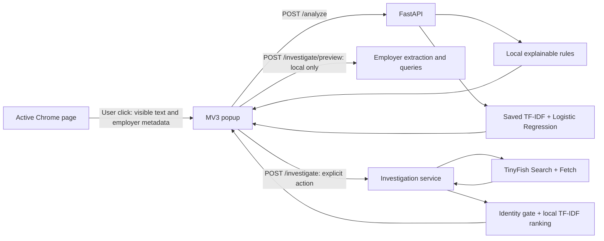

# VeriShield AI

**Check the posting. Investigate the employer. Apply with better evidence.**

A hackathon project prepared for **Kritical Hacks 2026**: a Chrome extension with a local FastAPI backend that screens job and internship advertisements using explainable rules, a custom text classifier, and optional TinyFish live-web employer research.

VeriShield separates rule findings, the ML prediction, employer evidence, website-domain indicators, and recruitment email assessments in an explainable dashboard. It does not certify an offer or automatically establish that an employer is fraudulent. No external LLM API is used.

## Problem

Students and job seekers encounter advertisements requesting fees, promising guaranteed selection, or making employer claims that are difficult to check. An advertisement can look professional while its promises remain unsupported. A text classifier alone cannot establish whether the named employer or a particular offer is authentic.

## Solution and target users

VeriShield combines fast local screening with an explicit, user-triggered employer investigation. It shows why a rule fired, reports the classifier separately, and links relevant public sources so a person can inspect the claims.

The intended users are students, internship applicants, early-career job seekers, and placement teams supporting applicants. Institutional accounts and team workflows are proposals, not implemented features.

## Core features

- Chrome Manifest V3 popup with **Scan This Page** and **Investigate Employer** actions.
- Click-triggered extraction of rendered top-frame text, plus a single JobPosting employer from available JSON-LD metadata.
- Seven explainable suspicious-pattern rules with matched excerpts and capped rule points.
- Locally trained TF-IDF + Logistic Regression classifier; no fabricated predictions or external model API.
- Employer-name preview and correction before investigation; generic identities such as Careers and Jobs are rejected.
- Actual TinyFish Search and Fetch calls, employer-specific queries, source filtering, and local passage ranking.
- Separate confirmed official, external employer-related, unverified related, and excluded-source diagnostics.
- Claim filtering that favors job-description assertions over navigation, salary-search links, related jobs, and advertisements.
- Explicit missing-model, missing-key, timeout, quota, and partial-retrieval handling.
- Unicode handling and disclosure when recognizable encoding artifacts are repaired for display.

All extracted claims remain unverified until independently reviewed. Text similarity is relevance, not factual proof.

## Security dashboard

The popup contains eight sections: job information, overall advisory, ML output, suspicious patterns, employer investigation, domain impersonation analysis, recruitment email analysis, and a deterministic final recommendation. The model fraud-class output is explicitly not necessarily a calibrated fraud probability. Existing Scan This Page and Investigate Employer actions remain available.

Local domain checks use offline registered-domain parsing, IDNA normalization, normalized edit distance, misleading-subdomain checks, and limited character-substitution matching. Recruitment email checks distinguish organizational domains, lookalikes, public providers, third-party recruitment platforms, and unknown ownership. Public providers and platform mismatches alone are not proof of fraud.

Official domains require the existing independently reviewed operator registry; a TinyFish search mention or supplied website does not establish ownership. Without an established domain, comparisons report unavailable. These checks reuse investigation results without extra TinyFish requests or model retraining. See [domain algorithms and manual checks](docs/domain_impersonation.md) and [email assessment and privacy limits](docs/recruitment_email_verification.md).

Advisories are **No major warning indicators detected**, **Review recommended**, **Elevated warning indicators**, or **Insufficient information**. They are deterministic summaries of actual findings, not a combined fraud probability or a safety guarantee.

## Architecture



The investigation retrieval vectorizer is separate from the frozen fraud classifier. Neither rule points nor evidence scores are added to the ML output. See [architecture](docs/architecture.md).

## Technology stack

| Layer | Implemented technology |
| --- | --- |
| Browser | Chrome MV3, HTML, CSS, vanilla JavaScript |
| HTTP service | Python 3.12, FastAPI, Uvicorn, Pydantic |
| ML | scikit-learn 1.7.2, TF-IDF, Logistic Regression, NumPy/SciPy, Joblib |
| Web investigation | TinyFish Search + Fetch REST APIs through HTTPX |
| Domain comparison | tldextract with its offline Public Suffix List |
| Configuration/testing | python-dotenv, pytest, FastAPI TestClient, HTTPX MockTransport, Node test runner |

`requirements-lock.txt` pins the tested environment; `requirements.txt` declares direct dependencies. Node is needed only for extension tests, not for running the extension or backend.

## ML methodology and actual results

The original [Real / Fake Job Posting Prediction dataset](https://www.kaggle.com/datasets/shivamb/real-or-fake-fake-jobposting-prediction), published by Shivam Bansal and acknowledging the University of the Aegean, supplies the labels: `0` legitimate, `1` fraudulent. Kaggle lists it as **CC0 Public Domain**. The CSV and model binary are deliberately excluded from Git; download the original CSV and train locally.

The supplied CSV contains 17,880 rows: 17,014 legitimate and 866 fraudulent. Missing text becomes empty strings; invalid labels are not imputed. Removing 2,008 duplicate normalized text inputs leaves 15,872 records. Identical normalized descriptions stay in the same split through the first fold of seeded StratifiedGroupKFold. Vocabulary, IDF, and balanced class weights are learned only from training rows.

Features combine title, company profile, description, requirements, and benefits. TF-IDF uses unigrams/bigrams, at most 60,000 features, min_df=2, and sublinear term frequency. Logistic Regression uses balanced class weights, liblinear, C=1, max_iter=1000, and seed 42. No synthetic training data or test-set tuning is used.

Measured on **3,131 held-out records**, after training on **12,741 records**:

| Metric | Actual result |
| --- | ---: |
| Accuracy | 97.51% |
| Fraud precision | 74.51% |
| Fraud recall | 74.51% |
| Fraud F1 | 74.51% |
| Always-legitimate accuracy baseline | 95.11% |

Confusion matrix, rows actual and columns predicted, ordered legitimate/fraudulent:

```text
[[2939,  39],
 [  39, 114]]
```

These are historical holdout results, not measured effectiveness on arbitrary current Chrome pages. Balanced-model probabilities are not calibrated real-world fraud likelihoods. Exact metrics, source checksum, split counts, and versions are in [evaluation.json](ml/reports/evaluation.json); see [ML methodology](docs/ml_methodology.md).

## Windows setup: complete application

Prerequisites: **Python 3.12**, Chrome, and Git. Node.js 20+ is optional for the extension tests (tested locally with Node 24). Use PowerShell from the repository root after cloning your submitted GitHub repository. Do not initialize another repository.

### 1. Install the backend dependencies

```powershell
py -3.12 -m venv .venv
.\.venv\Scripts\python.exe -m pip install -r requirements-lock.txt
.\.venv\Scripts\python.exe -m pip check
```

Skip environment creation if using an existing compatible environment. Calling its executable directly avoids changing PowerShell execution policies. The pinned dependencies have not been validated on every Python version or operating system.

### 2. Supply the real dataset and train the model

Download and unzip `fake_job_postings.csv` from the Kaggle dataset page above. Kaggle may require sign-in. Put the file here:

```text
ml/data/fake_job_postings.csv
```

Then run:

```powershell
.\.venv\Scripts\python.exe -m ml.train
```

This writes `ml/artifacts/job_classifier.joblib` and regenerates inspection, evaluation, and split reports under `ml/reports/`. Only original dataset labels are used. A fresh public clone has no model until this step is completed. If your trusted trained artifact is already present, skip training. Never load untrusted Joblib artifacts.

### 3. Configure optional TinyFish access

Local rules and ML do not require a key. Employer web investigation requires a TinyFish key from [the TinyFish dashboard](https://agent.tinyfish.ai/api-keys).

```powershell
Copy-Item backend/.env.example backend/.env
```

Run the copy only when `backend/.env` does not already exist. Edit that file locally:

```dotenv
TINYFISH_API_KEY=your_actual_key
```

The filename must be `.env`, not `.env.txt`. Never put the key in the extension, a commit, or a screenshot. No key is included in this repository.

Optional local settings can be copied from `.env.example` to the repository-root `.env`:

| Setting | Default / purpose |
| --- | --- |
| TINYFISH_API_KEY | Empty; place the real value in backend/.env |
| VERISHIELD_MAX_TEXT_CHARS | 50000; backend validation limit, 1-200000 |
| VERISHIELD_MODEL_PATH | Project's ml/artifacts/job_classifier.joblib; use an absolute override path |

Process environment values take precedence, followed by backend/.env, then legacy root .env. Restart the backend after changing configuration or training. The extension has a separate 50,000-character extraction cap.

### 4. Run FastAPI

```powershell
.\.venv\Scripts\python.exe -m uvicorn backend.app.main:app --host 127.0.0.1 --port 8000 --reload
```

Keep the terminal open. Visit [health](http://127.0.0.1:8000/health) or [interactive API docs](http://127.0.0.1:8000/docs). Health confirms the service is alive, not that the model/key is available. ML availability is reported inside `/analyze` responses.

### 5. Load the Chrome extension

1. Open `chrome://extensions` and enable **Developer mode**.
2. Choose **Load unpacked** and select this project's `extension` directory, containing `manifest.json`.
3. Pin VeriShield AI from Chrome's Extensions menu.
4. Open a normal HTTP(S) job posting, wait for it to load, then click **Scan This Page**.
5. Inspect rule findings and the separate ML result. Confirm/correct the employer name shown in the preview.
6. Optionally click **Investigate Employer** and keep the popup open for up to 90 seconds.
7. Inspect the source categories, related passages, excluded-source diagnostics, and unverified claims.

After editing extension files, reload it at `chrome://extensions`. No Chrome build process or npm install is required. The extension's persistent host permission is limited to `http://127.0.0.1:8000/*`; keep the API address consistent in `popup.js`, `manifest.json`, and the Uvicorn command.

## API routes

| Method/path | Behavior |
| --- | --- |
| GET /health | Service liveness |
| POST /analyze | Local rules and separately reported ML prediction |
| POST /investigate/preview | Local employer selection and generated queries; no web calls |
| POST /investigate | TinyFish retrieval and structured investigation report |

`/analyze` accepts required nonblank `text` and optional `title`, `url`, `employer_name`, and `structured_employer_name`. `/investigate` and `/investigate/preview` also accept optional `official_website`. Explicit employer input takes precedence. A supplied website is a claim, not proof of ownership. Unknown fields or invalid inputs return HTTP 422. The analysis and investigation responses add `job_information`, `domain_analysis`, `email_analysis`, and `advisory` without removing existing fields. See `/docs` for the generated schemas.

```powershell
$payload = @{ text = 'Pay a registration fee. Guaranteed job.' } | ConvertTo-Json
Invoke-RestMethod -Method Post -Uri http://127.0.0.1:8000/analyze -ContentType 'application/json' -Body $payload
```

This is a request example, not live evidence or an ML evaluation sample.

## TinyFish integration and verification

The backend makes actual `X-API-Key`-authenticated calls to TinyFish Search and Fetch. It does not call TinyFish Agent/Research or another LLM API. Search uses quoted employer-specific queries; Fetch requests fresh content with ttl=0. Complete employer-name matching is mandatory before supporting evidence is admitted. Ranking combines TF-IDF cosine similarity, entity/company-name matching, domain comparison, and source relevance.

Official status requires an operator-reviewed domain registry entry plus fetched identity matching; none is pre-declared. External company profiles may be self-reported. All claims remain unverified until reviewed. See [TinyFish integration](docs/tinyfish_integration.md) for categories, limits, error handling, and the registry policy.

To explicitly check real retrieval (requires network access and TinyFish allowance):

```powershell
.\.venv\Scripts\python.exe -m backend.tools.verify_tinyfish --employer "Legal Raasta Technologies Pvt. Ltd." --output backend/reports/live_tinyfish_verification_submission.json
```

Exit 0 and `live_retrieval_verified: true` require successful Search and live Fetch with matching nonempty page content. The ignored receipt records sources, excerpts, hashes, and available provider request IDs. A successful retrieval is not verification of an internship. Automated tests use mocked HTTP and cannot establish live API access.

## Tests and troubleshooting

```powershell
.\.venv\Scripts\python.exe -m pytest backend/tests ml/tests -q
node --test extension/tests/popup.test.cjs
node --check extension/popup.js
```

With the original CSV and model present, the security-feature suite has 115 backend/ML tests and 7 mocked popup tests. Some artifact/data-dependent tests skip without those local files, so a green run with skips is not equivalent to full validation. A current dependency emits a Starlette TestClient deprecation warning; this does not change model results.

- **Backend unreachable:** start Uvicorn, open `/health`, and confirm port 8000 is available.
- **ML unavailable:** train using the original CSV, check the artifact path/version, and restart FastAPI.
- **Investigation not configured:** check backend/.env and restart; local scans still work.
- **Missing employer:** enter its full name; generic headings are deliberately rejected.
- **No evidence/partial result:** inspect diagnostics. Blocked, unrelated, and empty pages are not supporting evidence.
- **Chrome access denied/no text:** use an ordinary HTML job page outside internal Chrome pages, the Web Store, or PDF viewers.

## Screenshots and demo

These are submission placeholders, not claimed completed artifacts:

| Asset to add | Suggested location | Status |
| --- | --- | --- |
| Local scan showing rule findings and ML output | docs/screenshots/local-scan.png | Pending real capture |
| Employer investigation and relevant source links | docs/screenshots/employer-investigation.png | Pending real capture |
| Excluded-source diagnostics and uncertainty | docs/screenshots/source-diagnostics.png | Pending real capture |
| Walkthrough video | Add a public video link here | Pending recording/upload |

Capture the real app with the backend running; remove personal data, keys, browser accounts, and unrelated tabs before publication. No fabricated screenshots or demo URL is included.

## Known limitations

- Domain and email checks are offline indicators, not ownership or sender authentication. Agency recruitment, alternate brands, and stale registry entries can cause false positives. Platform/provider/confusable lists and private-interface detection are incomplete; scan public job pages deliberately.

- Historical single holdout; not company-disjoint or temporal. Near-duplicate templates and overlapping company profiles may remain.
- Rule/claim extraction and employer matching are English-oriented heuristics with false positives and false negatives. Unusual layouts and unlabeled ads can defeat filtering.
- Up to 50,000 characters of top-frame rendered text; no image OCR, iframe content, form values, PDF analysis, or automatic background monitoring.
- Closing the popup ends its UI session; no saved scan history or account system exists.
- Employer-name similarity, external profiles, and related passages do not prove identity, claim truth, or offer authenticity. Missing evidence does not prove fraud.
- Known mojibake can be repaired for display, but irreversibly damaged text cannot be recovered.
- TinyFish availability, allowances, and source access affect investigations; no guaranteed complete crawl is provided.
- Local development server has no authentication, durable job queue, or production multi-tenant controls. Bind to loopback, not a public interface.
- Chrome behavior has automated mocked-browser coverage; manual screenshot/demo capture is still required for submission.

## Revenue model (proposed, not implemented)

Potential paths are a free local applicant tool, optional paid investigation allowances, and institutional subscriptions for placement teams. No billing, customer contracts, pricing validation, revenue, or market-size claims are implemented or asserted. Cost assumptions include web-retrieval usage, hosting, support, security, and compliance. See [revenue model](docs/revenue_model.md).

## Future scope (not implemented)

- Independently labeled current-page evaluation, calibration, and stronger company/temporal holdouts.
- Better job-section selection, multilingual extraction, and richer identity disambiguation.
- Human-reviewed official-domain coverage and explicit contradiction/date checks.
- Persistent investigations, accessible larger result views, institutional controls, and production deployment hardening.

## Repository guide

```text
extension/                 MV3 manifest, popup, and browser-mocked tests
backend/app/               FastAPI routes, rule engine, configuration, schemas
backend/app/investigation/  Claims, TinyFish client, source validation/ranking
backend/tests/             API, relevance, claim and Unicode tests
backend/tools/             Explicit real-network verification CLI
ml/                        Dataset preparation, training, shared preprocessing, inference
ml/reports/                Actual dataset audit and holdout reports
ml/data/                   Local original CSV (ignored)
ml/artifacts/              Local trained Joblib bundle (ignored)
docs/                      Architecture, ML, TinyFish, revenue, and readiness docs
```

## License, attribution, and submission readiness

Original project code/documentation is under the [MIT license](LICENSE). External packages retain their own licenses; see [third-party notices](THIRD_PARTY_NOTICES.md). The external dataset is separately listed as CC0 on Kaggle and is not bundled. TinyFish is an external service governed by its terms; fetched web pages retain their owners' rights.

See [security and readiness review](docs/submission_readiness.md) before committing. Credentials, virtual environments, dataset/model binaries, caches, and local live receipts are excluded. No repository was pushed as part of submission preparation.
